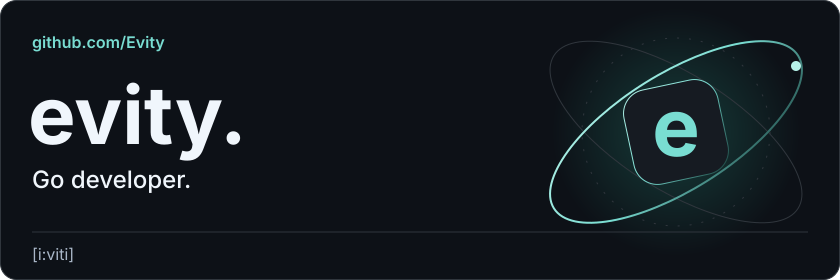
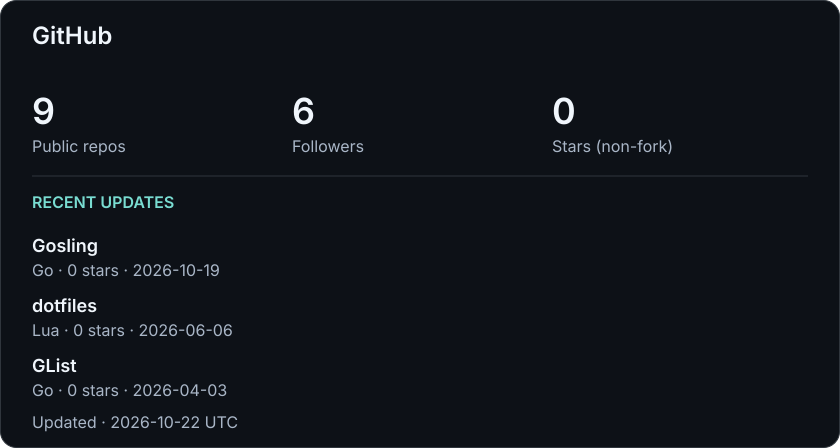
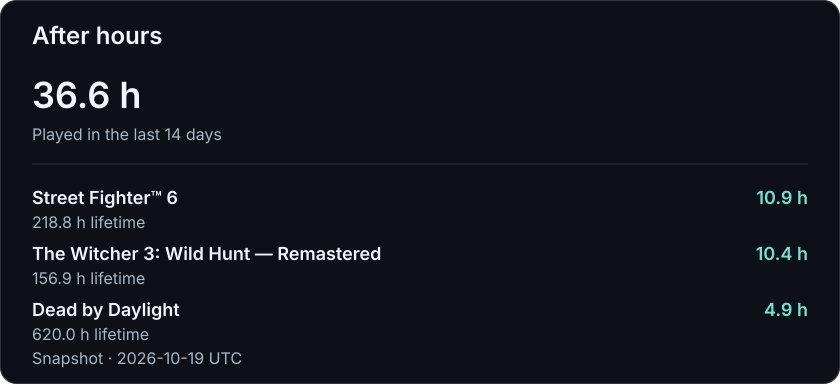

<picture>
  <source media="(max-width: 600px)" srcset="assets/header-mobile.svg">
  
</picture>

你好，我是 Evity，主要写 Go。`[i:viti]`

[Gosling](https://github.com/Evity/Gosling) · [GList](https://github.com/Evity/GList) · [dotfiles](https://github.com/Evity/dotfiles) · [全部仓库](https://github.com/Evity?tab=repositories)

### GitHub

<picture>
  <source media="(max-width: 600px)" srcset="assets/github-mobile.svg">
  
</picture>

### Steam

最近两周的游戏和时长。

<picture>
  <source media="(max-width: 600px)" srcset="assets/steam-mobile.svg">
  
</picture>

<!-- PROFILE:START -->

### 豆瓣与音乐

<picture>
  <source media="(max-width: 600px)" srcset="assets/culture-mobile.svg">
  
</picture>

[豆瓣主页](https://www.douban.com/people/Evity/)

<!-- PROFILE:END -->

---

[数据说明与配置](docs/dynamic-content.md)
